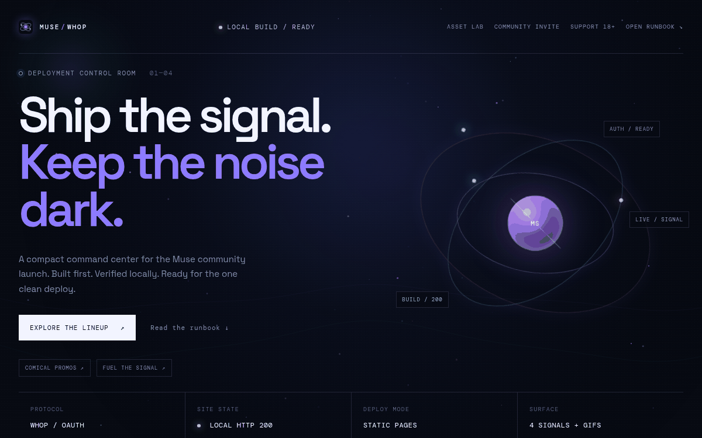
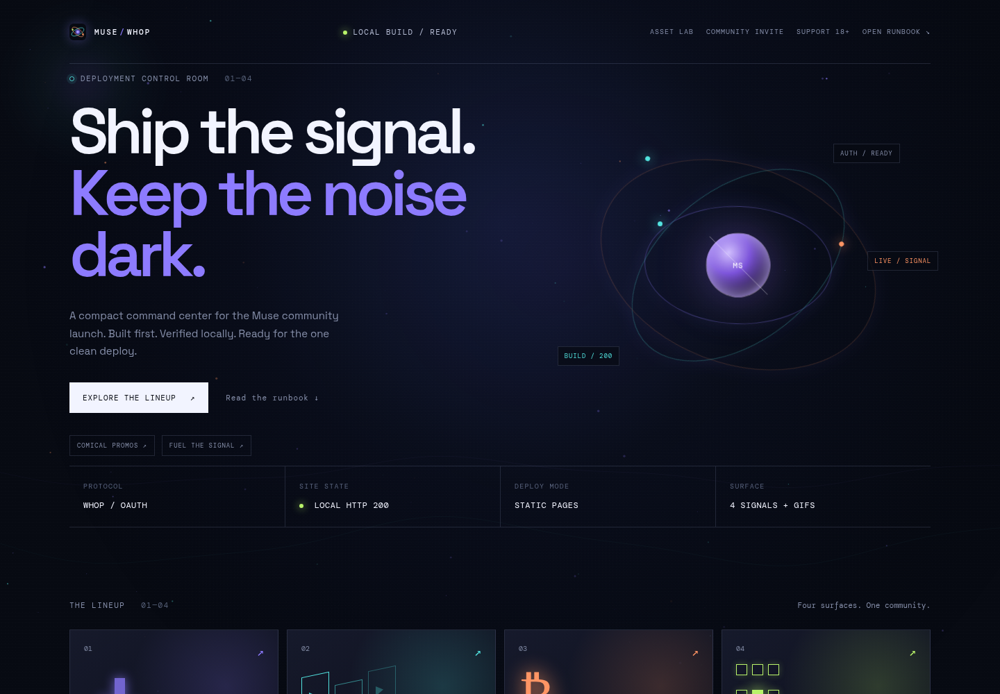
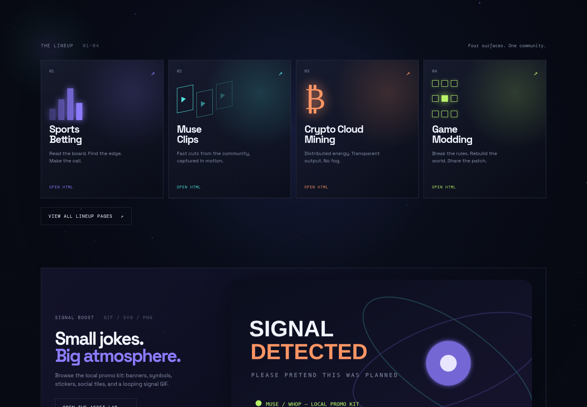
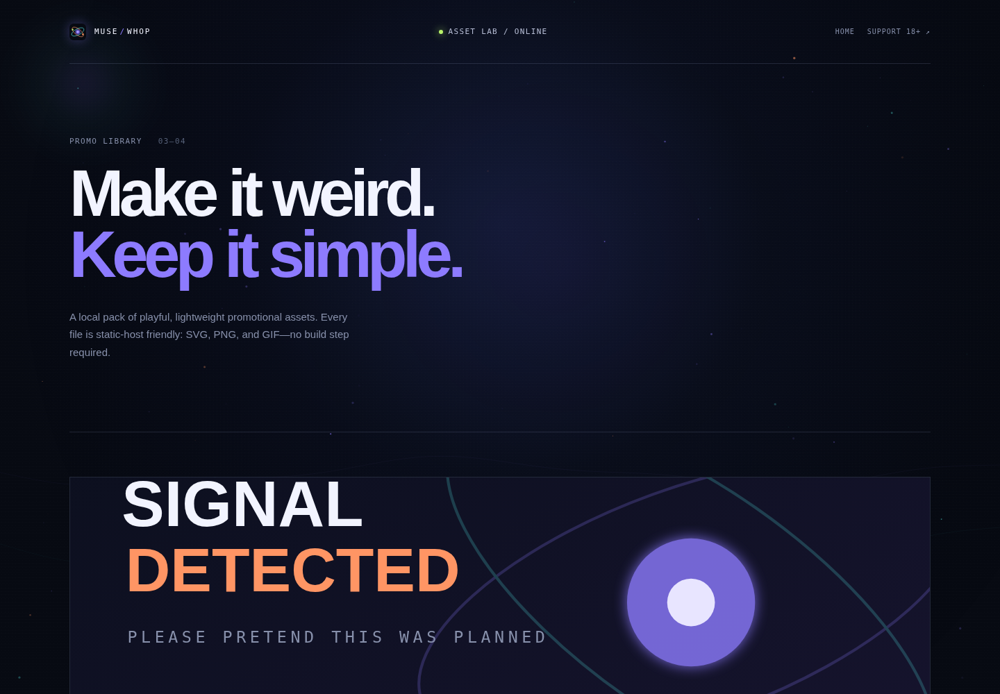
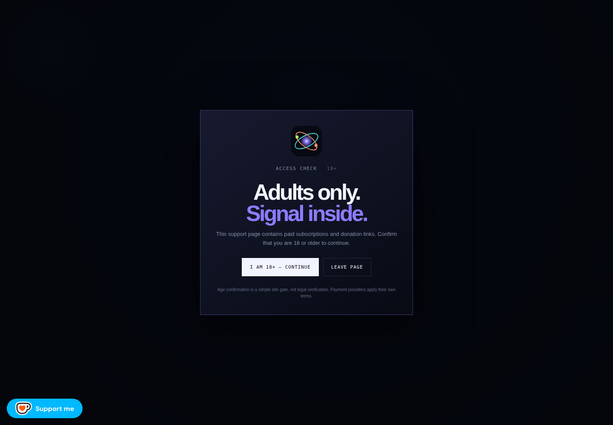

# Muse / Whop Control Room

A dark, animated static community launch surface with an orbiting signal background, playful local promo assets, page-based navigation, support flows, and an animated FED-OS footer.

> **Status:** local static project. No live demo or CI workflow is configured in this repository.

## Why this exists

Community launch pages often become a pile of dead buttons, raw Markdown links, generic payment embeds, and visual assets scattered outside the project. That makes the first visit confusing and makes static deployment harder than it needs to be.

This project turns the supplied Muse Whop runbook into a browsable, self-contained front-end. It keeps the public experience lightweight and static while giving every internal action a real HTML destination: lineup pages, the runbook, an asset lab, support, GitHub Sponsors, Discord, and the FedPromptly invite card.

The visual direction is intentionally different from a conventional dashboard. It uses a dark signal-room aesthetic, animated orbit geometry, canvas particles, glowing cards, comical promotional art, a ticker footer, and reduced-motion fallbacks. External services remain external; the bundle does not pretend to be a payment processor or a live API client.

## See it work

The fastest real demo is the homepage. It runs directly from this repository with Python’s built-in static server:

```bash
cd muse-whop
python3 -m http.server 8080
```

Open <http://localhost:8080> and select **Explore the lineup**, **Asset Lab**, **Community Invite**, or **Support 18+**. The project has no install step and no package manager.

### Real demo GIF

This GIF was captured from the running local application. It shows the homepage, lineup cards, hover state, and asset lab—not a mockup.



### Main entry points

- [`index.html`](index.html) — animated control-room homepage.
- [`lineup.html`](lineup.html) — four real HTML lineup destinations.
- [`gallery.html`](gallery.html) — local SVG, PNG, and GIF promo library.
- [`support.html`](support.html) — age gate, subscription, donation, community, and GitHub Sponsors card.
- [`discord.html`](discord.html) — Discord buttons, widget, and the non-direct 18+ NSFW access flow.
- [`invite.html`](invite.html) — animated FedPromptly invite button and modal card.
- [`runbook.html`](runbook.html) — static-host and deployment checklist.

## Screenshots

### Homepage control room



### Lineup and promo strip



### Asset lab



### Support age gate



The invite-card page is also captured at [`assets/demo/invite-button.png`](assets/demo/invite-button.png).

## Quick start

There is nothing to install. Run the static server, then open the local URL:

```bash
# run
python3 -m http.server 8080

# visit
# http://localhost:8080
```

For a basic repository sanity check:

```bash
# JavaScript syntax
node --check script.js

# Shell syntax
bash -n scripts/mint-token.sh
bash -n scripts/deploy.sh
```

The deployment scripts are operational examples from the supplied runbook. They require environment-provided credentials and should be reviewed before use:

```bash
export WHOP_CLIENT_SECRET='your-secret-in-the-shell'
bash scripts/deploy.sh
```

Do not put the secret, OAuth code, refresh-token JSON, or business API key into the repository.

## What is included

The front end is plain HTML, CSS, and JavaScript. `styles.css` contains the responsive visual system, orbit effects, animated cards, promo strip, support layout, invite-card styling, and the animated FED-OS footer. `script.js` supplies the canvas particle/wave background, pointer bloom, and reduced-motion handling.

The `assets/` directory contains the symbol favicon, brand mark, SVG banners, four lineup promos, stickers, social artwork, PNG badges, the looping `signal-loop.gif`, and the real demo captures under `assets/demo/`.

The support surface contains the supplied PayPal subscription, Stripe buy button, Ko-fi, Buy Me a Coffee, NOWPayments, GitHub Sponsors, Substack, and Discord destinations. These are third-party flows and may require network access, provider-side approval, or their own account terms.

## Static deployment

The repository is compatible with GitHub Pages and Cloudflare Pages because the application is a root-level static bundle with relative links and no build command. A GitHub Pages workflow is **not** included, and no live deployment was verified while preparing this README. Cloudflare Workers configuration is also not included; for Workers, serve this directory through the platform’s static asset mechanism rather than expecting a Node build.

For GitHub Pages, publish the repository root and use `index.html` as the entry point. For Cloudflare Pages, use the repository root as the output directory and leave the build command empty. Test locally first so third-party embeds do not obscure a markup or asset error.

## Safety and access notes

The support page presents a simple 18+ confirmation gate; it is not legal age verification. The NSFW Discord action does not redirect directly to the invite. After confirmation, it asks the visitor to email `museai@fedpromptly.com` for the redirected link.

The public footer intentionally includes public landing pages, contact addresses, media links, and public community entry points. Private Matrix, personal, country-locked, and restricted destinations are not placed in that footer.

## Project tree

```text
muse-whop/
├── index.html                 # main control room
├── lineup.html                # lineup index
├── gallery.html               # local asset lab
├── support.html               # 18+ support and payment surface
├── discord.html               # Discord buttons and access handling
├── invite.html                # FedPromptly invite modal
├── runbook.html               # HTML deployment runbook
├── file-tree.html             # browsable file tree
├── sports-betting.html        # lineup detail page
├── muse-clips.html            # lineup detail page
├── crypto-mining.html         # lineup detail page
├── game-modding.html          # lineup detail page
├── sponsor.html               # standalone GitHub Sponsors card
├── styles.css                 # shared visual system
├── script.js                  # canvas and pointer animation
├── site.webmanifest            # static-host metadata
├── assets/                    # favicon, promos, badges, GIFs
├── assets/demo/               # real screenshots and demo GIF
└── scripts/                   # token refresh and deploy helpers
```

## License

No license file is currently present. Until one is added, treat the repository as **all rights reserved** rather than assuming permission to reuse the code or artwork.
